# A8 – Gear Box Design
## Design of the shafts: Use the equations for stress outlined in lecture and Machinery’s Handbook determine if the input and output shafts’ diameters are sufficient.
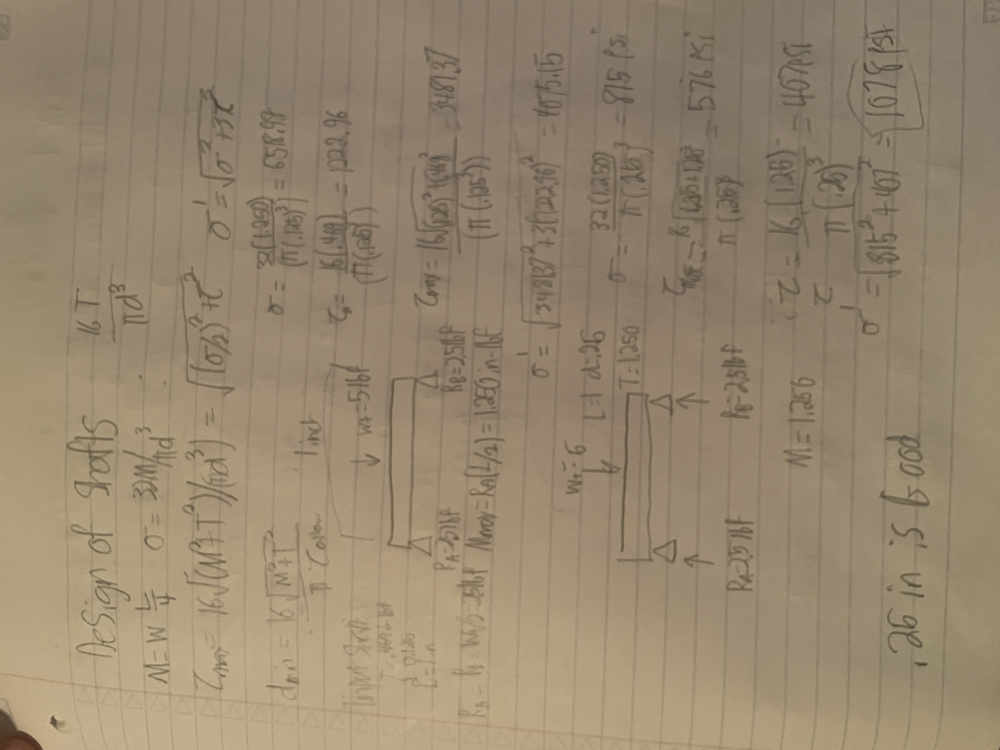
## Design journal bearings:
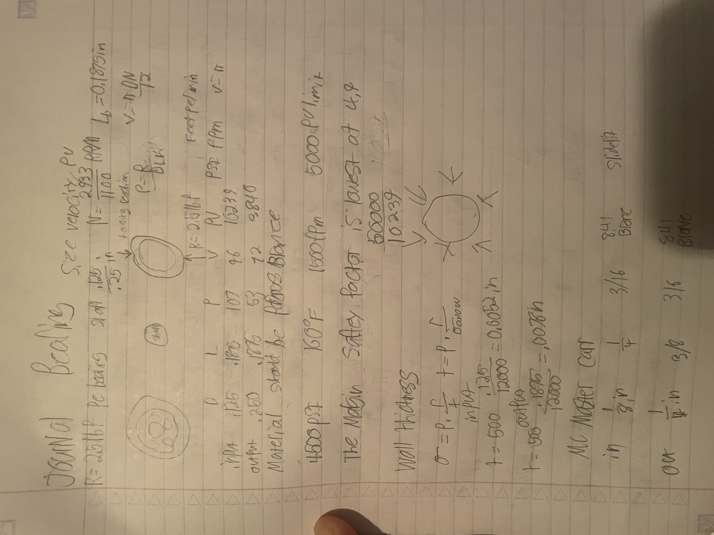
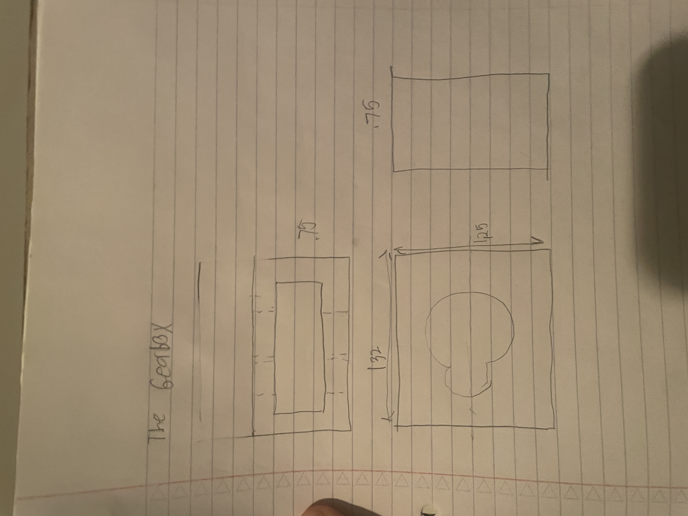
## Generate a CAD Model of the two halves of the gearbox.
McMaster wouldn't let me make an account
### All of the tolerances are in the drawings below
### All the Files https://drive.google.com/drive/folders/1YbYgOXixXVg7XmSgNTHKZOroIi1oFBeP?usp=sharing
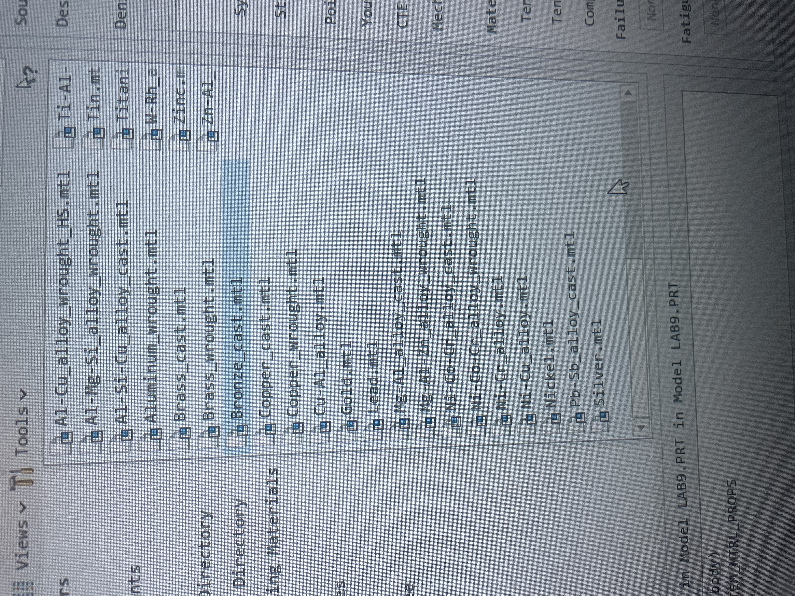
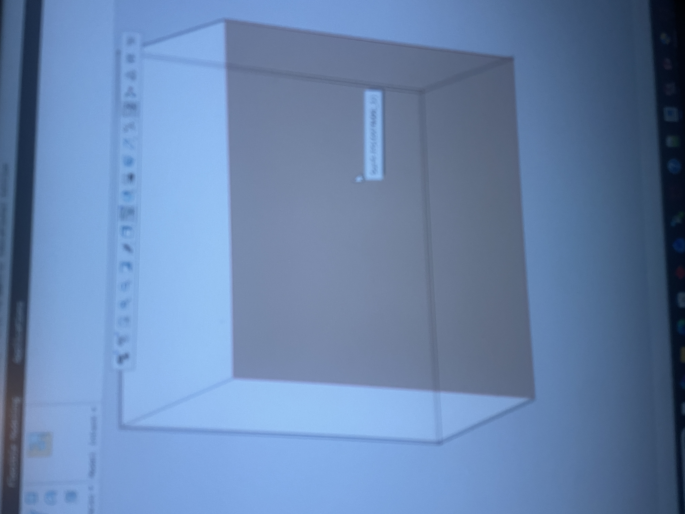
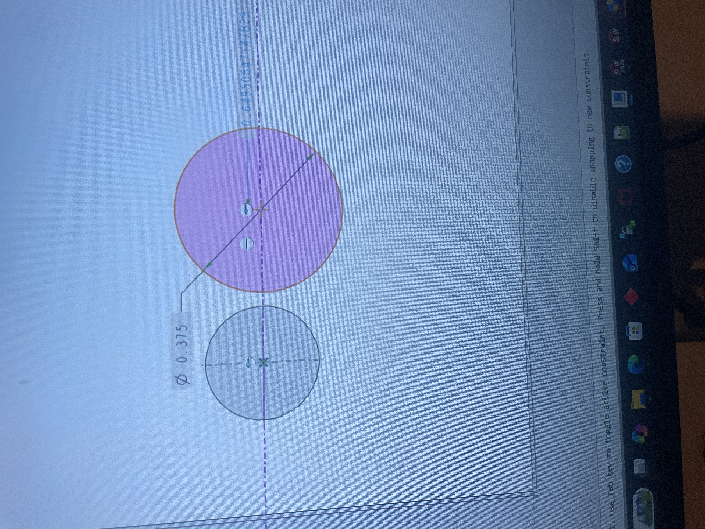
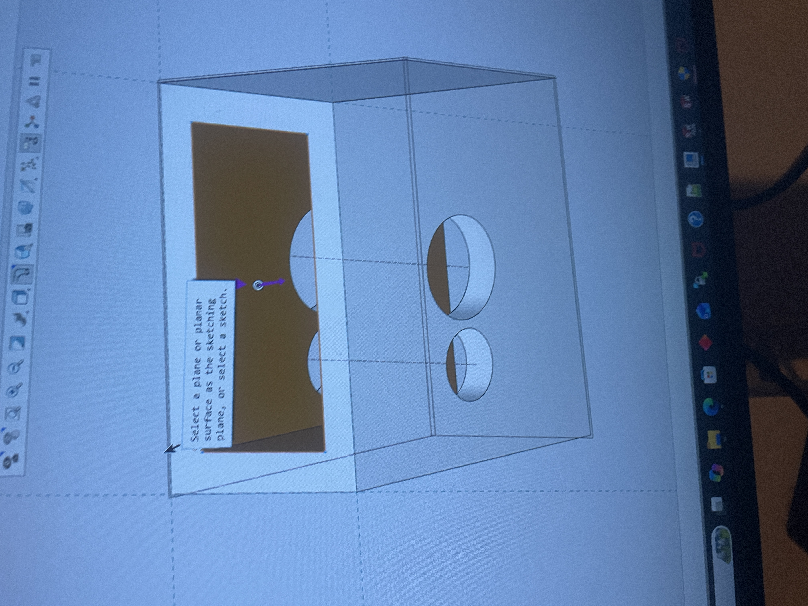
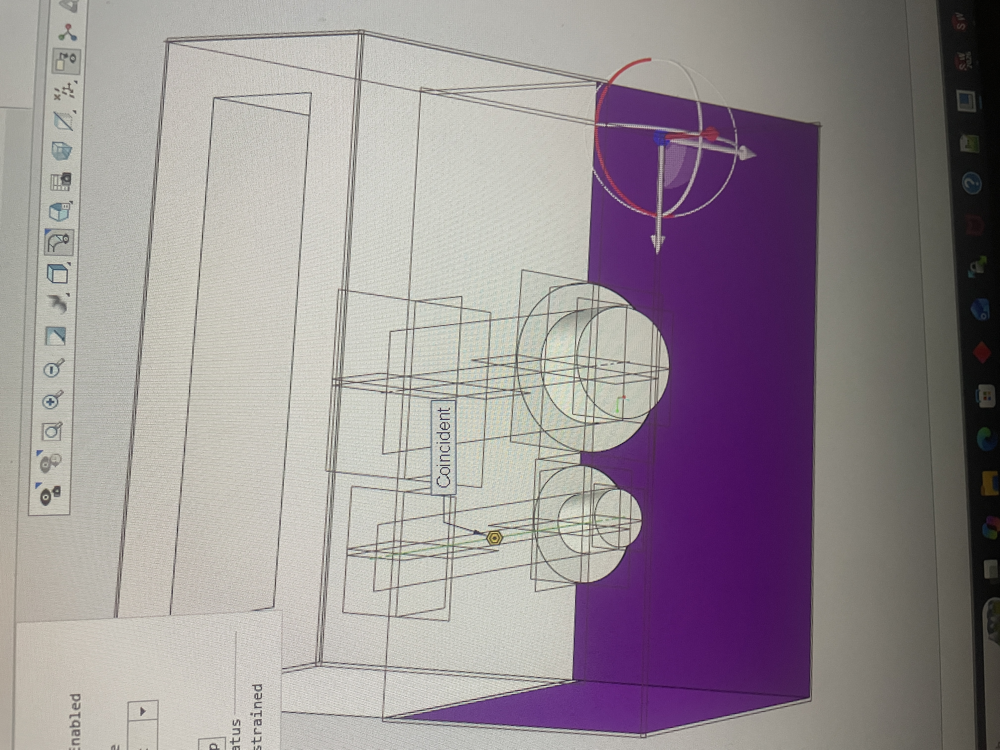
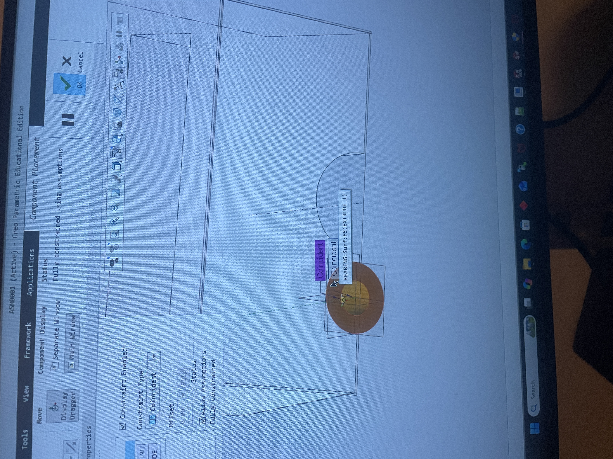
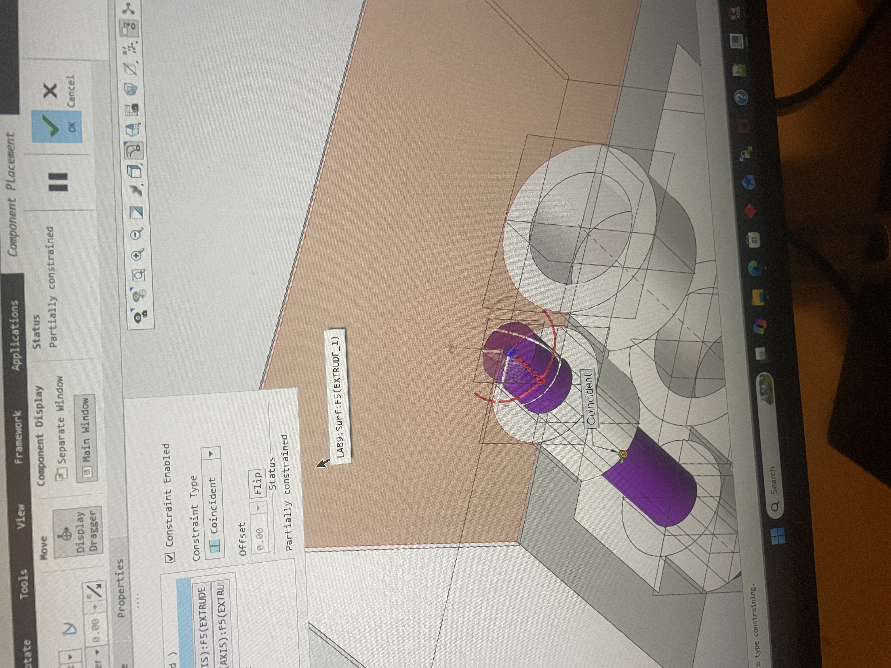
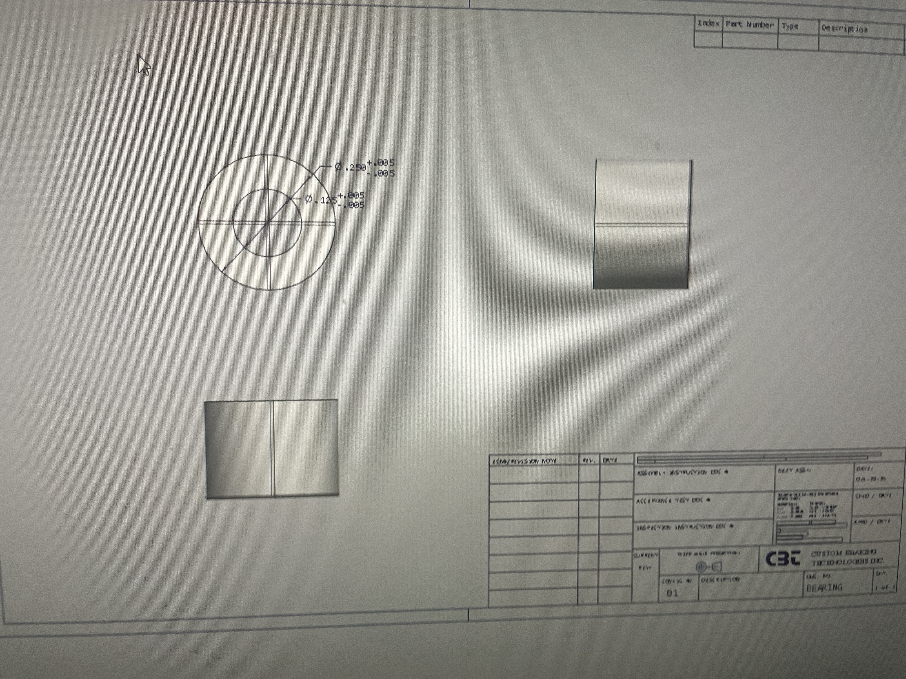
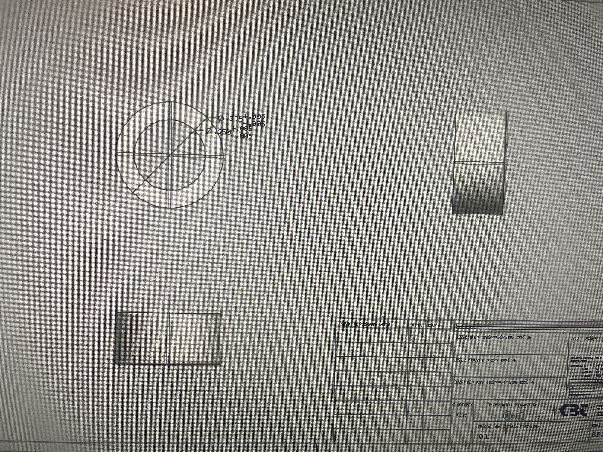
#### The gearbox halves use the same part Aswell as Drawinf
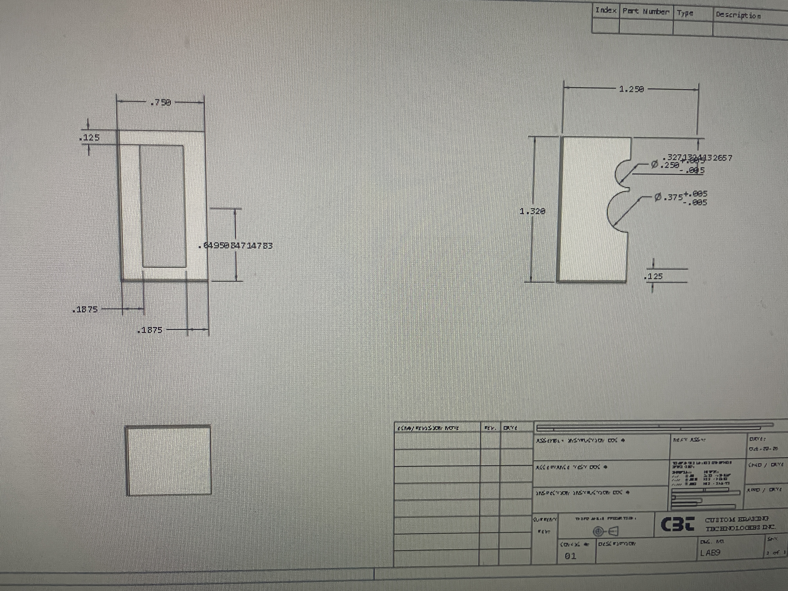

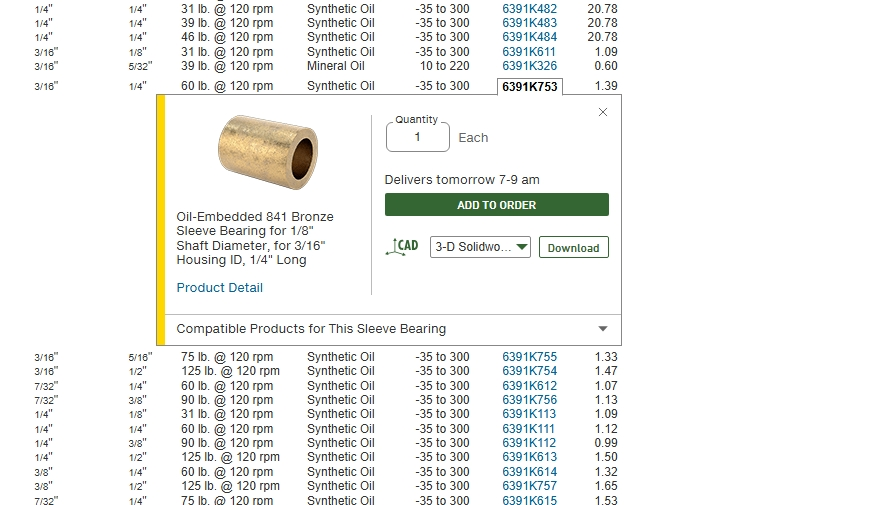
## Time spent and lessons Learned
I learned what it was like to put gears together in cad. I also learned how to calculate forces that would be affecting a bushing, and I was able to Taylor the right material so that the gearbox will be built with a high factor of safety. I also learned that sometimes you are unable to source the part you want I could not find a 1/4 outer and 3/16 inner bronze sleeve bushing.
