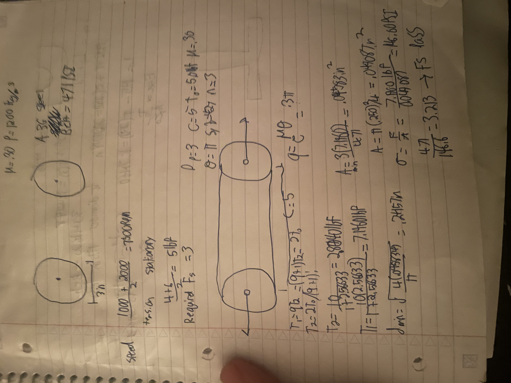
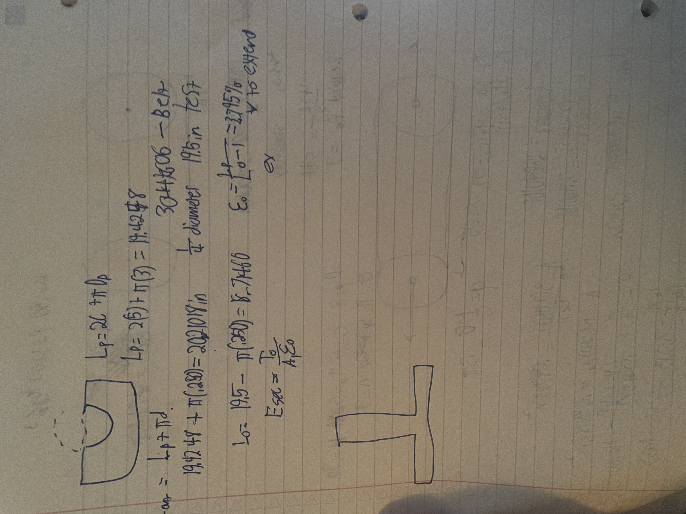

# A9 – Pulley System Design
## my design
### Use the following strategy to select a suitable belt from Resource #1. Calculate the forces on both the tight and loose side with no slippage. Calculate the diameter of the belt using the normal stress equation and yield strength. Calculate the belt's outer circumference then select a suitable belt.

### Model the equations and solve  them symbolically for minimum diameter.

### Lessons Learned
I learned it is more difficult than I thought to do this well. It is not that hard, but it takes a good amount of research to make sure you are using the right equations and math
