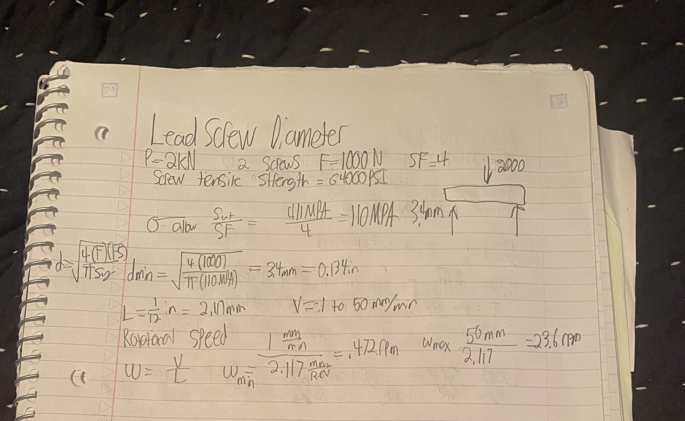
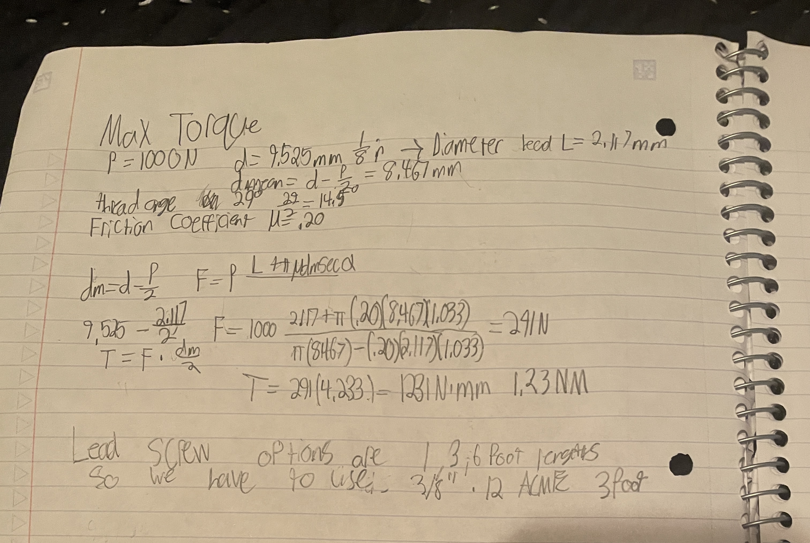
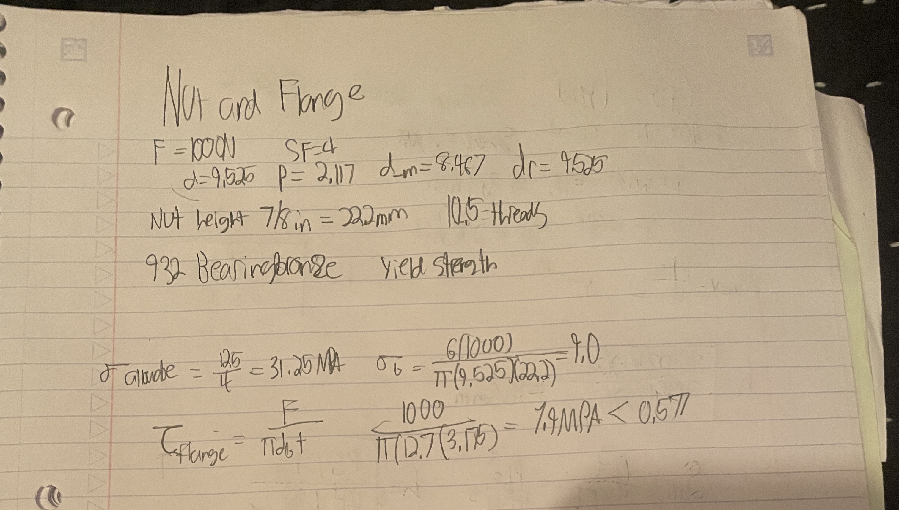
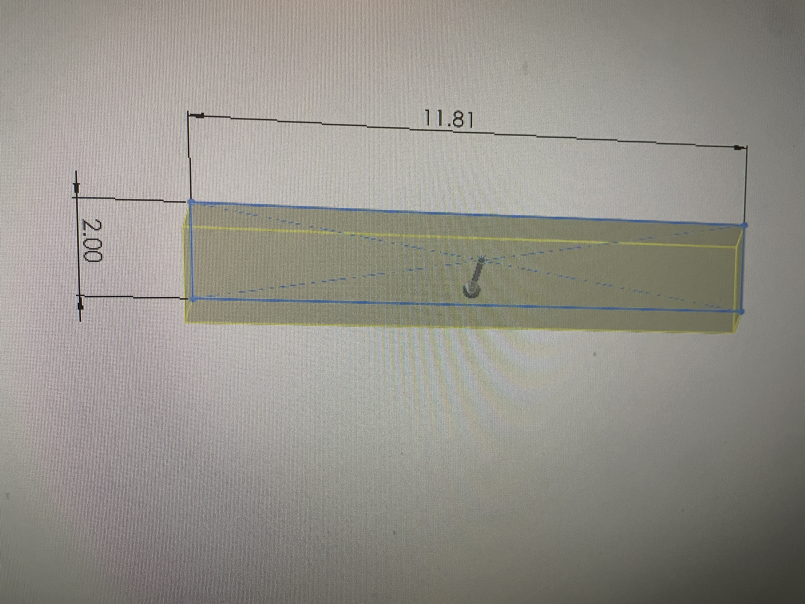
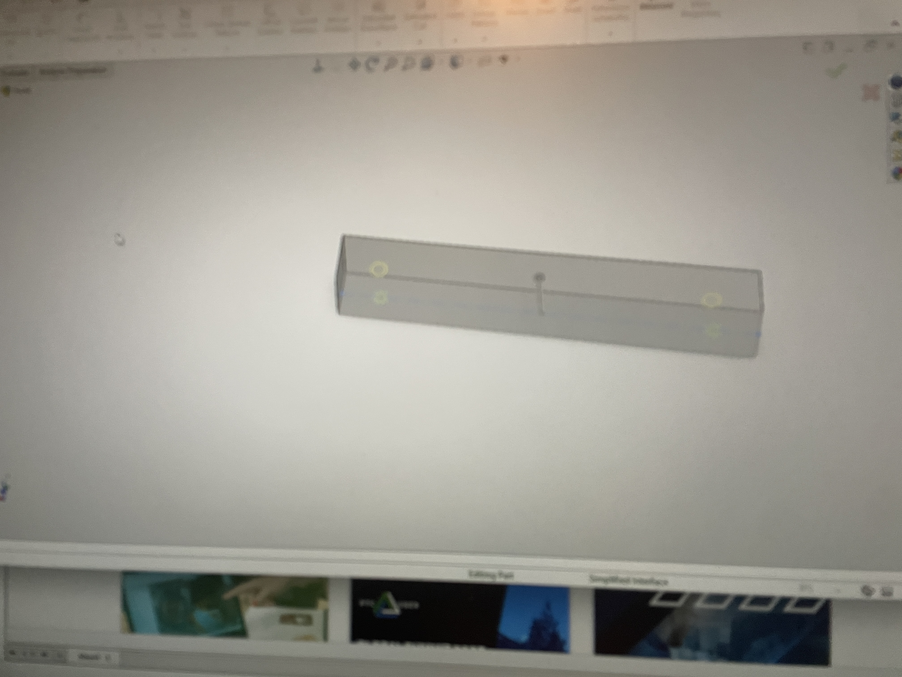
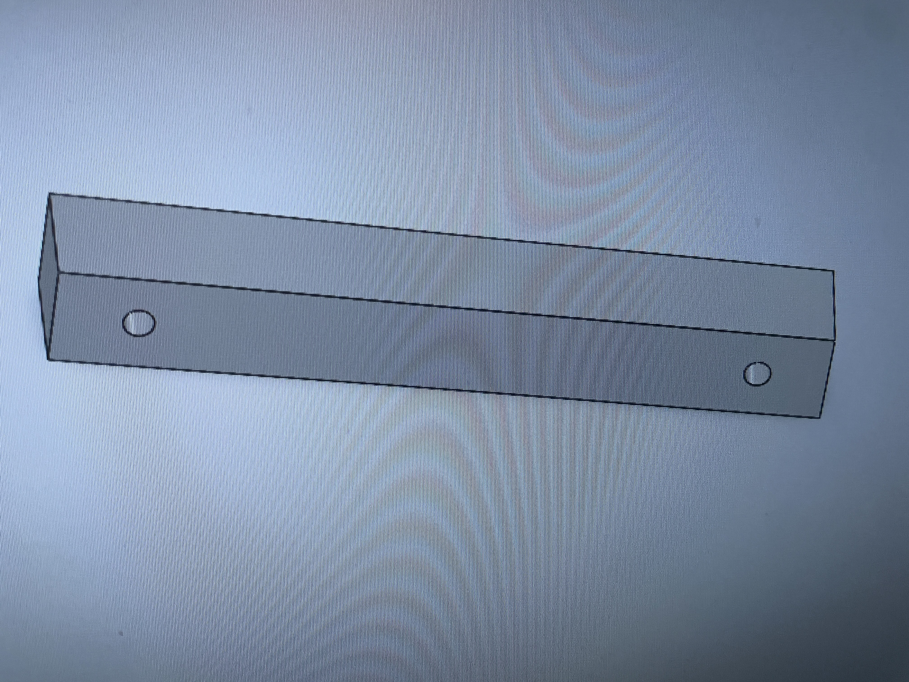

# A10 – Lead Screw Translating System
CAD ACCESS FOLDER. https://drive.google.com/drive/folders/1XlgFVTGdcgsS3MZ7Ju-onJi7chmYeZqd?usp=sharing
## Objective

!

## Leadscrew diameter (35pts):
The standard carbon steel Acme series is sold in 12 in, 3 ft, 6 ft and 12 ft lengths. The 3 ft screw, cut to about 24 in (610 mm), is the shortest option that clears the 18 in minimum with room for the supports.
| Item | McMaster # | Specs |
| --- | --- | --- |
| Lead screw (x2, identical) | [98935A817](https://www.mcmaster.com/98935A817/) | Carbon steel, 3/8"-12 Acme, right-hand, single start, 3 ft, 0.083" travel per turn, Class 2G, 64,000 psi tensile |
## Select a Nut and Flange (10pts):
The 95120A592 bronze flange nut passes the thread check with a safety factor of about 10.

| Item | McMaster # | Specs |
| --- | --- | --- |
| Flange nut (x2) | [95120A592](https://www.mcmaster.com/95120A592/) | 932 bearing bronze, 3/8"-12 Acme, right-hand, 7/8" tall, 1/2" barrel diameter, 1" flange diameter, 1/8" flange thickness, Class 2G |
## Design the Crosshead (25 pts):
Deflection governs the crosshead height. A 50.8 mm (2.000 in) tall 6061-T6 bar passes both checks.
[MEGR 2156-7 Title](IMG_7291.JPG)
## Tabulating Costs
| Item Number | Quantity | Name | Cost/Item | Cost | Purchase Link |
| --- | --- | --- | --- | --- | --- |
| 1 | 2 | Carbon Steel Acme Lead Screw, 3/8"-12, right-hand, 3 ft (98935A817) | 10.15 | 20.30 | [98935A817](https://www.mcmaster.com/98935A817/) |
| 2 | 2 | Bronze Acme Flange Nut, 3/8"-12, right-hand (95120A592) | 111.78 | 223.56 | [95120A592](https://www.mcmaster.com/95120A592/) |
| 3 | 2 | Clamping Acme Lead Screw Collar, 3/8"-12, black-oxide steel (6698K11) | 18.38 | 36.76 | [6698K11](https://www.mcmaster.com/6698K11/) |
| | | **Total Cost** |  | 280.62 | |
## Parametric Modeling

## FEA
## Lessons Learned
